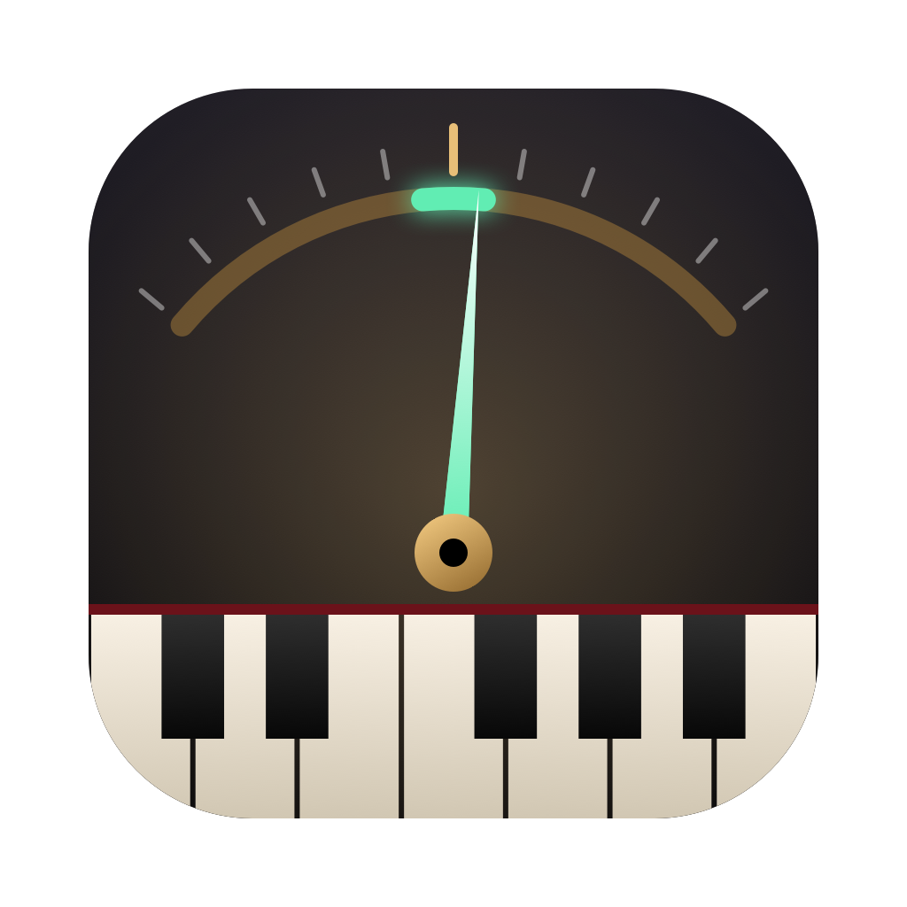
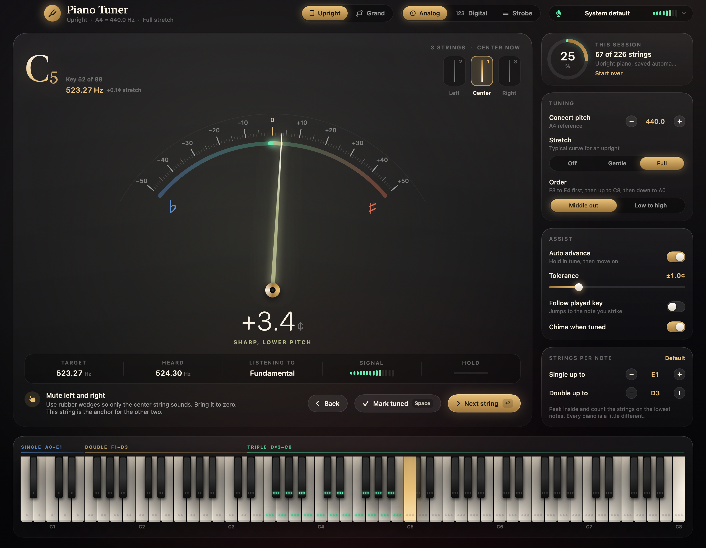
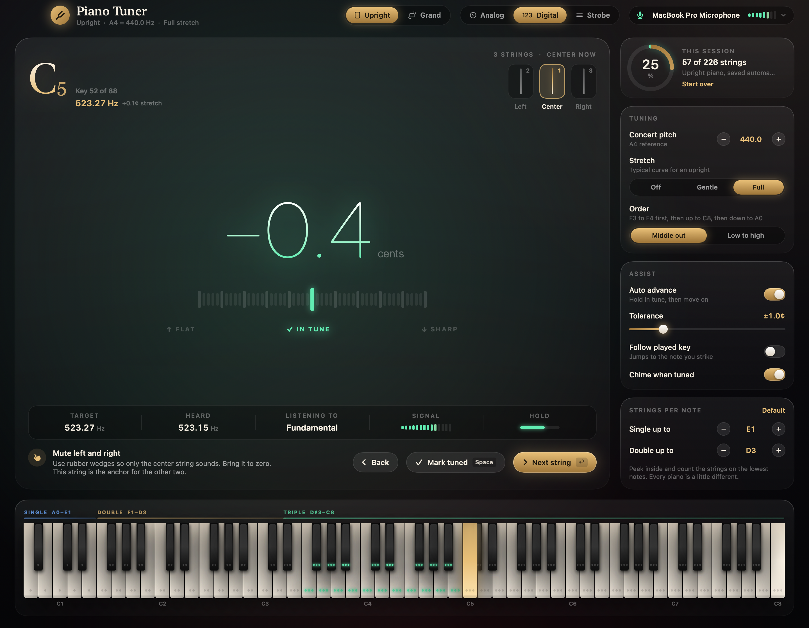
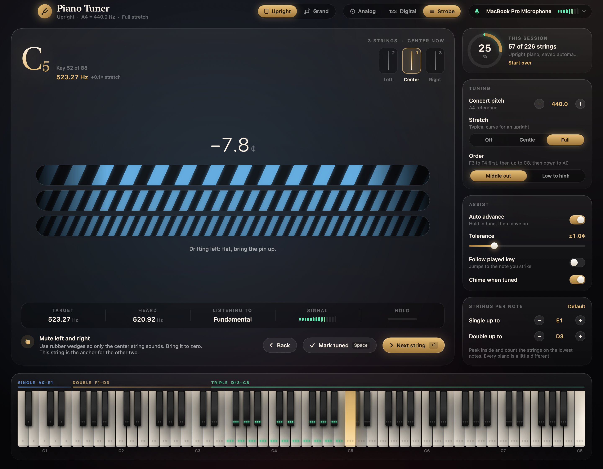

<p align="center">
  
</p>

<h1 align="center">Piano Tuner</h1>

<p align="center">
  A native macOS app for tuning a real piano, one string at a time.<br>
  Pick the key, pick the string, strike it, watch the needle.
</p>

<p align="center">
  
  
  
</p>

<p align="center">
  
</p>

## Why this exists

We have an upright piano at home and it drifts. Phone tuner apps are built for guitars. They guess which note you played, they wobble, and they have no idea that most piano notes have three strings that all need to agree.

Piano Tuner flips that around. You tell it exactly which key and which string you are working on, and it listens only for that. The result is a needle that sits still, a readout you can trust to a tenth of a cent, and a session that remembers where you left off.

Set a MacBook on top of the piano and use the built in mic, or plug in an external one and point it at the soundboard.

## What it does

**Tunes the string you choose.** Click any of the 88 keys, then choose the left, center or right string. The app shows the target frequency and listens only around it, so other ringing strings do not confuse it.

**Three ways to read pitch.**

| Analog | Digital | Strobe |
| --- | --- | --- |
| A sprung needle on a ±50 cent dial with a glowing in tune window. | Huge numerals and an LED bar for reading across the room. | Moving bands that stand still when the string is right, like the classic strobe tuners techs swear by. |

<p align="center">
  
  
</p>

**Walks you through unisons.** For a three string note it starts with the center string and tells you to mute the outer two. Then it moves to the left string, then the right. Two string and single string notes get their own steps. The mute instructions change between upright (rubber wedges) and grand (felt strip).

**Moves on by itself.** Hold a string inside your tolerance for about a second and a half and it gets marked as done, a soft chime plays, and the next string comes up. The order defaults to how a technician works: set F3 to F4 first, go up to the top, then come back down through the bass. Plain low to high is there too.

**Remembers your progress.** Little green dots on every key show which strings are finished. Close the app, come back tomorrow, carry on. Upright and grand sessions are tracked separately.

**Upright and grand modes.** Uprights have shorter, stiffer strings and need more octave stretch than a grand. Each mode has its own stretch curve and its own default string layout. You can adjust where single strings end and triple strings begin, because every piano is built a little differently.

**Hears the bass properly.** Laptop microphones barely pick up the fundamental of a low A0 at 27.5 Hz. In the bass the app listens to a higher partial instead (the 2nd, 3rd or 4th), which is what an aural tuner does when comparing octaves.

**Follow mode.** Turn on "Follow played key" and the app jumps to whichever note you strike. Handy for spot checks.

## Install

### Download

Grab `Piano-Tuner.zip` from the [latest release](https://github.com/corrooli/PianoTuner/releases/latest), unzip it and drag **Piano Tuner** into Applications.

The app is signed ad hoc, not notarized, so macOS will be suspicious the first time. Right click the app and choose **Open**, or run:

```sh
xattr -dr com.apple.quarantine "/Applications/Piano Tuner.app"
```

### Build from source

You only need the Xcode command line tools. No Xcode project, no dependencies.

```sh
git clone https://github.com/corrooli/PianoTuner.git
cd PianoTuner
./scripts/build-app.sh
open "build/Piano Tuner.app"
```

The script builds a universal binary (Apple Silicon and Intel), wraps it in an app bundle with the icon and microphone permission text, and signs it locally.

## Using it on a real piano

1. Place the Mac on top of the upright (lid closed works fine) or put an external mic near the strings.
2. Pick **Upright** or **Grand** at the top.
3. Open the piano and count the strings on the lowest notes. Adjust **Strings per note** if yours differ from the defaults.
4. Start at F3. Mute as the instruction card says, strike the key firmly and turn the tuning pin in very small moves.
5. When the needle settles in the green window, hold it there. The string gets ticked off and the next one comes up.

Keyboard shortcuts make it quicker when your hands are on a tuning lever:

| Key | Action |
| --- | --- |
| `←` `→` | Previous or next key |
| `↑` `↓` | Previous or next string |
| `Return` | Next string in tuning order |
| `Space` | Mark or unmark the current string |

> [!NOTE]
> Tuning pins are under a lot of tension. If your piano is far below pitch (more than 20 or 30 cents flat across the board), it usually needs a pitch raise in several passes, and that is a job worth handing to a technician.

## How the pitch detection works

Most tuner apps run a general pitch detector and hope for the best. This one knows the target, which allows a much more precise measurement.

1. Audio from the selected input is mixed to mono and kept in a ring buffer.
2. Around 25 times a second, a Hann windowed frame (85 to 340 ms depending on register) is zero padded 4x and run through a vDSP FFT.
3. The strongest peak within ±100 cents of the expected partial is located and refined with Gaussian interpolation.
4. A second frame taken a quarter frame later gives a phase difference at that bin. That phase advance pins the frequency down far more tightly than the FFT bin spacing allows (the phase vocoder method).
5. A median of the last few readings drives the needle, and a spring animation makes it move like a real meter.

On synthetic piano tones with inharmonic partials, decay and noise, the worst measurement error across the keyboard is under 0.05 cents. You can run that check yourself:

```sh
swift build -c release && .build/release/PianoTuner --selftest
```

Stretch follows a Railsback style curve: close to zero in the middle of the keyboard, rising to about +30 cents at C8 on an upright and +20 cents on a grand, and a smaller flat offset in the bass. "Gentle" uses 60 percent of that curve, "Off" gives pure equal temperament.

## Project layout

```
Sources/PianoTuner
├── Audio
│   ├── AudioInput.swift      microphone capture, device list, ring buffer
│   └── PitchAnalyzer.swift   FFT, phase vocoder refinement, key detection
├── Model
│   ├── Piano.swift           keys, string layouts, stretch, guidance text
│   └── TunerModel.swift      app state, analysis loop, auto advance, persistence
├── Views                     SwiftUI: gauge, digital, strobe, keyboard, settings
├── App.swift                 window setup and screenshot renderer
├── SelfTest.swift            synthetic accuracy test
└── main.swift
scripts
├── build-app.sh              builds the universal .app
└── make-icon.swift           draws the app icon
```

Everything is SwiftUI, AVFoundation, Core Audio and Accelerate. No third party code.

## Regenerating the screenshots

The screenshots in this README are rendered by the app itself with demo data:

```sh
.build/release/PianoTuner --snapshot docs/screenshot-analog.png --mode analog --cents 3.4
```

`--mode` takes `analog`, `digital` or `strobe`.

## A word of honesty

An app gets the strings close and gets them there fast. A good technician also listens for things a microphone cannot judge, like how the unisons bloom, how stable the pins feel and whether the whole instrument sounds even. Use Piano Tuner to keep your piano in shape between visits, and trust your ears for the final word.

## License

MIT. See [LICENSE](LICENSE).
